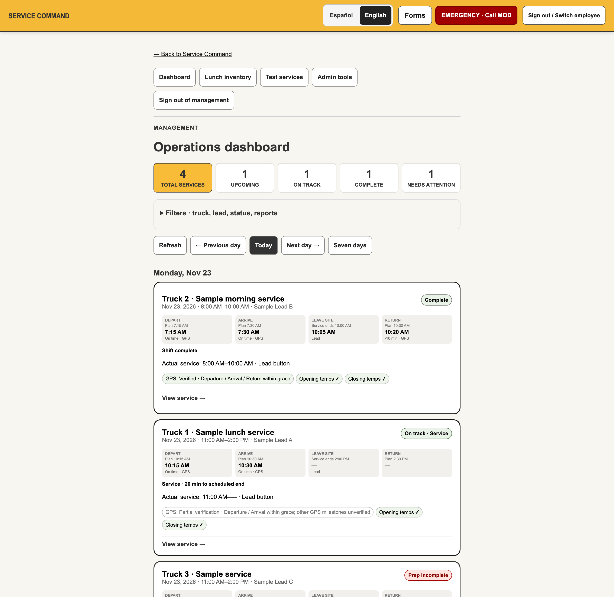
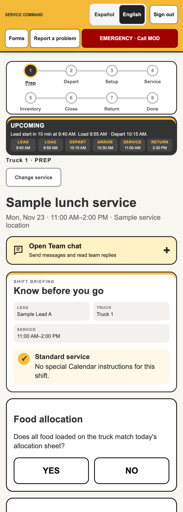
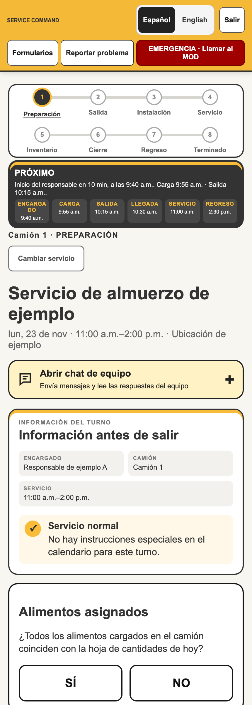
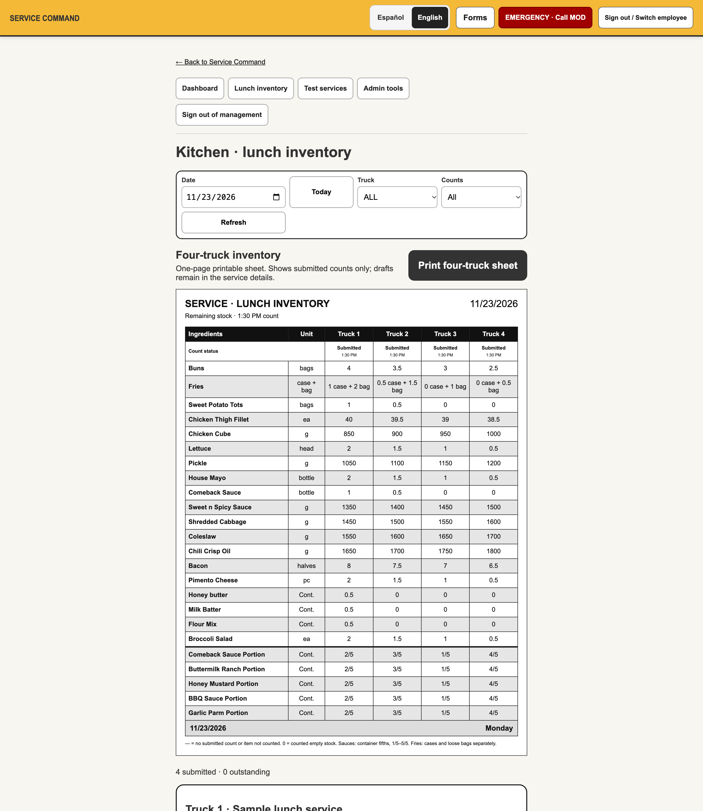
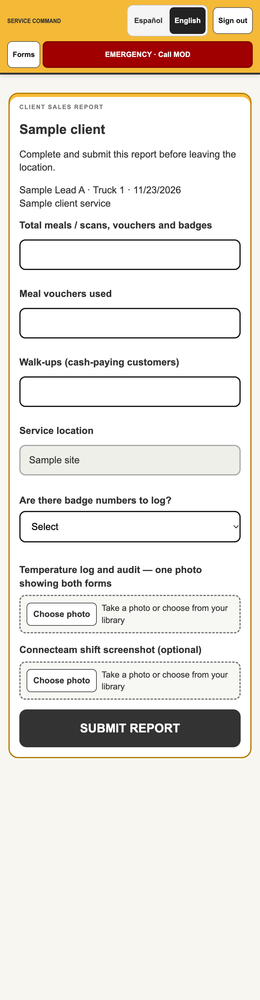
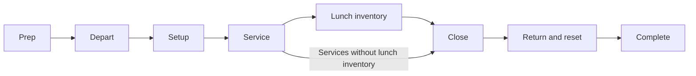
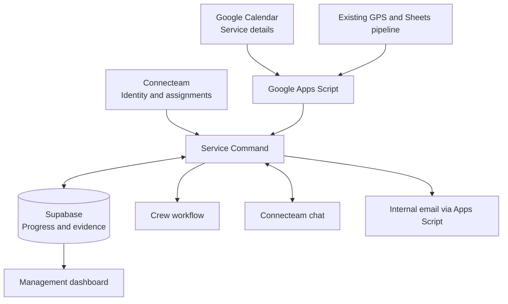

# Service Command

**A bilingual operations app that guides food-truck leads through service, from readiness checks to final closeout.**

I built Service Command to bring scheduling, food-safety checks, inventory, reporting and team communication into one mobile workflow. It connects the systems the operation already uses and gives managers a clear record of what happened during each service.

The application supports a four-truck operation, with employee screens in English or Spanish and a separate management dashboard.

## Screenshots

These are the app’s components and styles, rendered locally with fictional data and anonymized branding. All names, service locations, schedules and counts shown are examples; no live employee records or private service data were used.

### Management dashboard

Service totals, status filters, timing evidence and individual service cards in one view.

### Phone workflow in English and Spanish

The same service steps, readiness briefing and checklist controls in either language.

<table>
  <tr>
    <th>English</th>
    <th>Español</th>
  </tr>
  <tr>
    <td valign="top"></td>
    <td valign="top"></td>
  </tr>
</table>

<strong>View the four-truck inventory comparison</strong>

Submitted counts side by side in the original ingredient order, including whole/half units and container fifths. Every quantity in this example is fictional.

<strong>View a client sales report with photo inputs</strong>

A sample report form shows service-specific fields, an automatically filled site and required/optional photo controls. No employee photos, customer records or real sales figures are included.

## The problem it solves

A service lead needs to know where to go, what needs to be checked, when to count inventory and which reports to submit. That information can be spread across scheduling software, calendars, paper sheets, forms and chat.

Service Command brings those tasks into an ordered workflow. It checks the assigned destination, saves progress as work is completed, collects required evidence and makes the results available to management.

## A walkthrough

1. **Sign in with an existing Connecteam kiosk code.** The app identifies the employee and loads their published assignments without a separate staff login list.
2. **Verify the service.** Connecteam and Google Calendar must agree before the service opens and again before departure. A real conflict displays **Do Not Depart**.
3. **Prepare and set up.** Complete readiness checks, upload the equipment checklist photo, record departure and arrival, and mark **Service ready** separately from **Start service**.
4. **Run the service.** Record actual opening time, complete the lunch inventory and temperature checks, and communicate with the lead team from the app.
5. **Close and return.** Submit any required location-specific sales report and photos, finish closeout and return/reset checks, then complete the service.
6. **Review the operation.** Managers can inspect saved answers, timestamps, photos, inventory and reports, or print the four-truck inventory sheet.

Direct continuations stay within one operational workflow, with movement between stops rather than repeating the full checklist. Separate lunch and dinner services remain independent.

## Features

| Area | What the app does |
| --- | --- |
| Employee access | Verifies existing Connecteam kiosk codes on the server and retrieves published employee assignments across schedulers and pages. |
| Destination checks | Compares Connecteam shift titles with Calendar services using reviewed location aliases. Fresh checks remain required at opening and departure. |
| Saved workflow | Preserves progress across refreshes and sign-out. Earlier answers can be corrected without clearing later completed steps. |
| Food safety and evidence | Collects required checklist answers, temperature checks and equipment photos, with server-side requirements before advancement. |
| Lunch inventory | Uses the operation’s ingredient order and counting units, including whole/half counts and clickable container fifths for sauces. |
| Client reporting | Selects location-specific sales forms and required photos. Client report formats exclude the internal checklist. |
| Management dashboard | Provides service totals, status sorting, filters, evidence review and a printable four-truck inventory comparison. |
| Communication | Integrates team chat, private step reminders, internal summaries, problem-report emails and morning schedule-conflict emails. |
| Mobile interface | Offers English/Spanish screens, persistent operational tools, numeric entry controls and clear save/retry feedback. |

## How the systems connect

Connecteam supplies employee identity and assignments; Google Calendar supplies service details. A planning workbook provides optional timing context and reviewed naming references. Dispatch is not a required third source of agreement for travel approval. Existing Jotform links remain available for operational forms outside the app.

## Design decisions

- **Keep uncertainty visible.** Conflicting destinations stop travel instead of silently choosing a source. Managers can approve a corrected, matched destination without losing saved work.
- **Make completion mean saved.** Required inventory, photos and reports are checked on the server. A failed save does not count as completing a step.
- **Preserve the operational record.** Reviewing an earlier stage does not rewind the active service. Movement evidence and actual service times remain available to management.
- **Improve speed without weakening checks.** Independent reads run together, prepared assignments reduce repeated work, and confirmed saves update the screen without unnecessary full reloads. Fresh location checks still run at the travel gates.
- **Load chat history on demand.** The app initially retrieves the latest 50 saved messages. Older messages load in batches while preserving the reader’s position.

## Technology

Next.js · React · TypeScript · Supabase PostgreSQL and private Storage · Vercel · Google Apps Script · Google Calendar · Connecteam APIs and webhooks

The application also connects an existing GPS/Sheets pipeline and approved external operational forms.

## Validation and project status

The implementation’s reviewed source snapshot passed **348 automated tests** and a production build. Tests cover assignment matching, location holds, saved progress, stage corrections, inventory gates, photos, reports, messaging and direct continuations.

This case study contains no live credentials, employee records, chat history, service photos or business configuration.

## About this repository

This is a visual case study of the product, workflow and engineering decisions. It includes screenshots with fictional data and anonymized branding. The operational implementation, live services, company configuration and credentials are not included.
